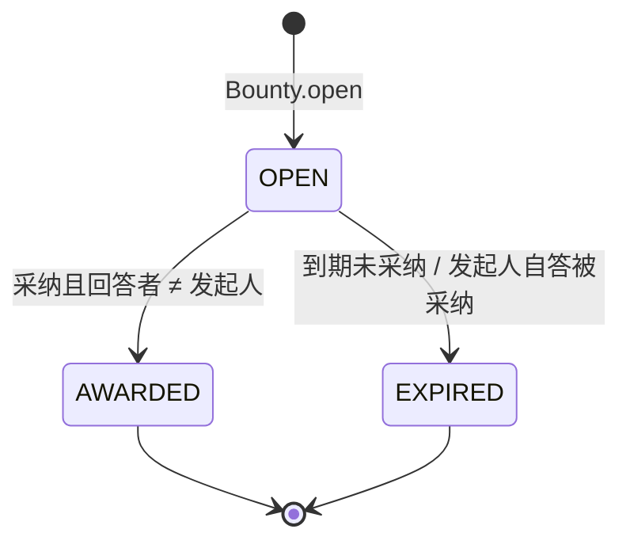

# 聚合清单与不变量（Aggregates & Invariants）

> 来源：起始代码的聚合类、领域测试与指导书 V2 第 3.4 节。聚合是**一致性边界**：
> 一个事务只修改一个聚合；跨聚合的一致性用领域事件和最终一致。

## 1. Identity（参考实现）

| 聚合根 / 实体 | 不变量 | 关键方法 |
| --- | --- | --- |
| `User` | 用户名唯一；密码 8–64 位且含字母与数字；`verify/changeRole/disable` 先校验管理员；禁用后不能登录 | `register`、`createStaff`、`verify`、`changeRole`、`disable`、`reconstitute` |
| `Course` | 只有教师/管理员能建课；课程教师角色不可被降级；课程代码 + 学期唯一 | `create`、`assignRole` |
| `CourseMember` | 同一用户在同一课程只有一条成员记录；角色 ∈ {STUDENT, TA, TEACHER} | — |

## 2. Q&A

| 聚合 | 聚合根 | 不变量 | 待实现方法 |
| --- | --- | --- | --- |
| 问题 | `Question` | 标题 10–150 字；正文 ≥20 字；标签 1–5 个且去重；最多一个被采纳答案且不可更改；只有提问者/课程管理者可采纳；已删除不可回答/编辑/采纳；有回答时提问者不能删除 | `post`、`edit`、`accept`、`softDelete`、`ensureOpenForAnswers`、`ensureNotDeleted` |
| 回答 | `Answer` | 只能回答未删除的问题；被采纳的回答作者不能删除；教师认证只能一次；已删除不可编辑/认证 | `submit`、`edit`、`endorse`、`softDelete`、`ensureNotDeleted` |
| 投票 | `Vote` | 每人每内容一票；值 ∈ {−1, 0, +1}；不能给自己投票；改投按差值计分 | `cast`、`change`、`checkValue` |
| 评论 | `Comment` | 正文 2–600 字；只允许一层回复；回复必须与父评论同一目标 | `post` |

**Q&A 跨聚合规则**：`Answer` 不持有 `Question` 对象，只持有 `questionId`；采纳由 `Question` 聚合决定，
`Answer` 只记录自身状态。回答数、票数、浏览数**不回写聚合**，由仓储原子 SQL 维护（ADR-008）。

## 3. Reputation

| 聚合 / 策略 | 类型 | 不变量 | 待实现方法 |
| --- | --- | --- | --- |
| `ReputationAccount` | 聚合根 | `reputation` = 账本流水之和；`availablePoints`、`frozenPoints` 不可为负；冻结/扣减/退款必须成对 | `open`、`applyReputation`、`freezePoints`、`spendFrozen`、`refundFrozen`、`ensureFrozen`、`requirePositive` |
| `Bounty` | 聚合根（状态机） | 同一问题最多一个 OPEN 悬赏；积分 10–500；期限 1–14 天；OPEN → AWARDED / EXPIRED，终态不可变；发起人不能赢得自己的悬赏 | `open`、`award`、`close`、`isDue`、`ensureOpen` |
| `ReputationRulebook` | 领域策略 | 采纳 +15、被赞 +10、被踩 −2；改投按差值；每日正向投票所得 ≤200；自问自答不加分 | `voteEffect`、`voteDelta`、`applyDailyCap`、`initialPoints` |
| `BadgePolicy` | 领域策略（纯函数） | 按采纳数/声誉阈值决定应得徽章；同一徽章不重复授予 | `forAcceptedCount`、`forReputation` |
| `AcademicTerm` | 领域服务（静态） | 校园时区 `Asia/Shanghai`；学期：2–7 月春季、8 月–次年 1 月秋季；ISO 周/月键 | `termKey`、`weekKey`、`monthKey` |

**悬赏状态机**：

## 4. Discovery

| 聚合 / 值对象 | 不变量 | 待实现方法 |
| --- | --- | --- |
| `Notification` | 接收者、类型、标题、链接、来源事件；`(sourceEventId, recipientId)` 唯一；只有接收者能标记已读 | `create`、`markRead` |
| `SearchDocument` | 每个问题一条投影；删除问题标记删除；回答数/得分/采纳状态最终一致 | —（由 `SearchIndexProjector` 维护） |
| `SearchQuery` | 关键词 ≤50 字符；词项 ≥2 字符；≤5 个词项；清洗全文检索运算符 | `terms`、`terms(String)` |
| `RelatedQuestionPolicy` | Jaccard 相似度；同分时得分高、已采纳优先；排除自身 | `jaccard`、`rank` |
| `MentionParser` | 提取 @昵称，去重保序，每条最多 5 人 | `extract` |

## 5. 聚合设计检查清单（Code Review 用）

- [ ] 聚合根的方法是否完成**全部**业务校验？应用服务里是否还有 if-else 业务规则？
- [ ] 聚合是否只引用其他聚合的 ID，而不是对象？
- [ ] 是否一个事务只改一个聚合？跨聚合是否用事件？
- [ ] 计数器是否只读，变化是否走 `adjustXxx` 原子 SQL？
- [ ] `reconstitute` 是否只还原状态、不做业务校验？
- [ ] 每个不变量是否至少有一条领域测试？测试名是否直接描述不变量？
