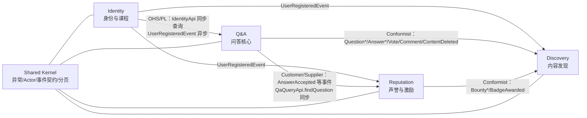

# 上下文映射（Context Map）

> 来源：指导书 V2 第 3.1、3.2 节 + 起始代码 `backend/*/*-api` 的实际依赖。Sprint 0 事件风暴已对照确认。

## 1. 子域划分

| 子域 | 类型 | 对应上下文 | 判断依据 |
| --- | --- | --- | --- |
| 课程问答 | 核心域 | Q&A | 平台存在的理由；“只能采纳一次”“已删除不可回答”等规则最复杂、最体现差异化 |
| 激励与声誉 | 核心域 | Reputation | 决定社区能否持续活跃；账本、悬赏、反作弊规则是本校定制的“游戏规则” |
| 身份与课程 | 支撑子域 | Identity | 必要但不独特；校园身份认证、课程成员关系是授权依据 |
| 内容发现 | 通用/支撑子域 | Discovery | 搜索、推荐、通知是通用能力，可替换为 Elasticsearch 或独立服务（ADR-001 演进路径中的第一拆分候选） |

## 2. 限界上下文

| 上下文 | 职责 | 对外发布语言 | 拥有的数据（表前缀） |
| --- | --- | --- | --- |
| Identity | 注册/登录、校园身份、角色、课程与成员 | `IdentityApi`、`UserSummary`、`CourseSummary`、`UserRegisteredEvent` | `id_user`、`id_course`、`id_course_member` |
| Q&A | 问题、回答、评论、投票、采纳、教师认证、软删除、查询 | `QaQueryApi`、`QuestionRef`、`Question* / Answer* / VoteCast / CommentPosted / ContentDeleted` 事件 | `qa_question`、`qa_answer`、`qa_vote`、`qa_comment`、`qa_tag` |
| Reputation | 声誉账户、账本、计分规则、徽章、悬赏、排行榜、对账 | `ReputationApi`、`ReputationSummary`、`ReputationChanged / BadgeAwarded / Bounty*` 事件 | `rep_account`、`rep_ledger`、`rep_badge`、`rep_bounty` |
| Discovery | 搜索投影、全文检索、相关推荐、@提及、通知 | 无同步发布语言；消费其他上下文事件，对外提供 REST 查询 | `dis_search_doc`、`dis_notification`、`dis_processed_event` |

## 3. 上下文映射图

> 箭头指向下游；实线为 Maven 依赖或事件订阅。跨上下文**禁止**直接 import 对方的 `domain` / `application` / `infrastructure`。

## 4. 关系模式与集成方式

| 上游 → 下游 | 关系模式 | 集成方式 | 说明 |
| --- | --- | --- | --- |
| Identity → Q&A / Reputation / Discovery | 开放主机服务 + 发布语言（OHS/PL） | 同步 `IdentityApi`；异步 `UserRegisteredEvent` | 下游只拿 `UserSummary`，不含学号、邮箱等个人信息 |
| Q&A → Reputation | 客户/供应商（Customer/Supplier） | 异步 `AnswerAccepted` / `AnswerSubmitted` / `AnswerEndorsed` / `VoteCast`；同步 `QaQueryApi.findQuestion` | Reputation 需要 `questionAuthorId` 等字段，由 Q&A 在事件中提供 |
| Q&A → Discovery | 遵奉者（Conformist） | 异步 `Question*` / `Answer*` / `VoteCast` / `CommentPosted` / `ContentDeleted` | Discovery 把事件折叠为自己的 `SearchDocument` 投影 |
| Reputation → Discovery | 遵奉者（Conformist） | 异步 `Bounty*` / `BadgeAwarded` / `ReputationChanged` | 用于“悬赏中”筛选、悬赏/徽章通知、排行榜 |
| 全部上下文 | 共享内核（Shared Kernel） | Maven 依赖 `co-shared-kernel` | 修改共享内核须全组评审（影响所有上下文） |

## 5. 防腐层与规则

- **同步查询**一律经 `*-api` 接口；应用层注入接口，基础设施层由 Spring 装配实现。
- **异步集成**一律经事务性发件箱（ADR-002）；事件 record 放在上游 `*-api`，下游只依赖该模块。
- **不共享数据库表**：每个上下文只读写自己的表；跨上下文需要的数据通过 API 或事件获得。
- **不共享领域对象**：`QuestionRef`、`UserSummary` 是只读发布语言，不是聚合。
- **课程管理者判定**统一走 `IdentityApi.canManageCourse(userId, courseId)`；领域方法接收 `actorManagesCourse` 布尔值，不注入 IdentityApi。
- **个人信息最小化**：发布语言不暴露学号、邮箱；需要展示时由 Identity 返回 `displayName`。

## 6. 演进路径（ADR-001）

当前是模块化单体：一个进程、一个数据库、四个上下文。若未来拆分：

1. Discovery 最先拆（搜索/通知对一致性要求最低，事件已解耦）；
2. 其次 Reputation（账本可独立扩缩容）；
3. Q&A 与 Identity 保留在单体（强事务、强一致）。

拆分的前提是：跨上下文只经 API/事件、每个上下文有独立 schema、发件箱可替换为 Kafka。当前代码已满足前两条。
