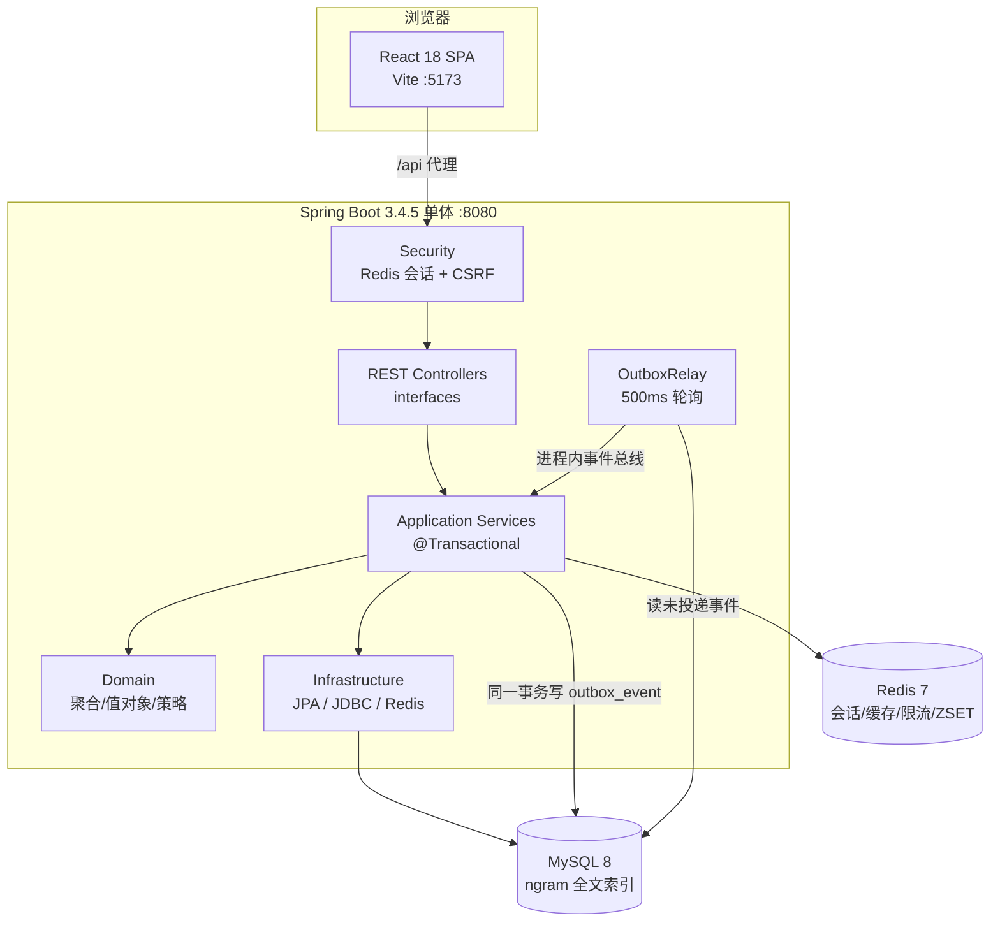
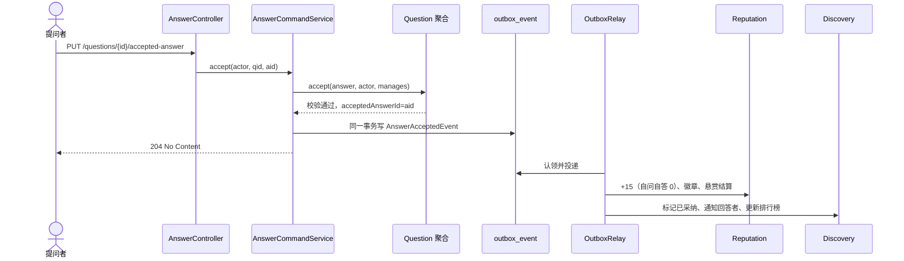

# 架构理解笔记（Sprint 0）

> 交付：T0-05 / PB-03。目标不是复述文档，而是**能对照代码讲清楚**：为什么这样分层、边界靠什么守住、
> 一次写操作为什么不会丢事件、Identity 为什么可以当模板。
>
> 阅读顺序：`README` → `docs/adr/001-008` → `co-identity` 四层 → `co-bootstrap` → `ArchitectureTest` → 本文。

## 1. 一页纸架构



**一句话**：模块化单体 = 一个进程、一个库，但用 Maven 模块 + ArchUnit 把四个上下文的边界“焊死”；
跨上下文只允许 `*-api` 同步查询或事务性发件箱异步事件。

## 2. 模块与分层

### 2.1 顶层模块（6 个聚合 POM + 27 个 Maven 模块）

```
co-shared-kernel   异常、Guard、Actor、IntegrationEvent、发件箱/幂等/审计端口、分页（零框架依赖）
co-identity        身份与课程（完整参考实现）
co-qa              问答核心
co-reputation      声誉与激励
co-discovery       内容发现
co-bootstrap       唯一可执行模块：安全链、发件箱中继、全局异常、OpenAPI、演示数据、ArchUnit/IT
```

每个上下文内部 5 层：`api / domain / application / infrastructure / interfaces`。

| 层 | 职责 | 允许依赖 | 典型类 |
| --- | --- | --- | --- |
| api | 发布语言：查询接口、只读 DTO、集成事件 record | 仅 JDK + 共享内核 | `QaQueryApi`、`QuestionRef`、`AnswerAcceptedEvent` |
| domain | 业务规则与不变量：聚合、值对象、领域策略、仓储接口 | 共享内核（禁止 Spring/JPA/Jackson） | `Question`、`Vote`、`Bounty`、`ReputationRulebook` |
| application | 用例编排、事务边界、端口定义 | domain + 本上下文/他上下文 api | `AnswerCommandService`、`BountyService` |
| infrastructure | 端口实现：JPA、JDBC 读模型、Redis、渲染器 | domain、application | `QuestionRepositoryAdapter`、`RedisLeaderboardStore` |
| interfaces | REST 控制器、请求校验、Actor 解析 | application | `QuestionController`、`BountyController` |

### 2.2 依赖方向（FF-4）

```
interfaces → application → domain ← infrastructure
                 ↓
            other contexts' api
```

- 领域层**不知道** Spring、JPA、HTTP、Redis；因此领域测试是毫秒级纯 JUnit。
- 基础设施实现领域层定义的端口（依赖倒置）；控制器不直接调用仓储适配器。
- 跨上下文只依赖对方 `*-api`，不能 import 对方 `domain/application/infrastructure`。

## 3. 架构适应度函数（ArchUnit FF-1～FF-8）

`co-bootstrap/src/test/java/.../architecture/ArchitectureTest.java` 把架构规则变成测试，CI 第 3 阶段单独运行：

| 编号 | 规则 | 违反时的典型错误 |
| --- | --- | --- |
| FF-1 | `..domain..` 不得依赖 Spring、JPA、Validation、Hibernate、Jackson、Swagger | 在聚合上加 `@Entity`、在领域层用 `@Component` |
| FF-2 | 一个上下文只能依赖其他上下文的 `api` 包 | Reputation 直接 import `com.campusoverflow.qa.domain.Question` |
| FF-3 | 上下文之间无循环依赖 | Q&A 反过来依赖 Reputation 的 api |
| FF-4 | 六边形分层方向：依赖只能由外向内 | 领域层调用应用服务；控制器直接调用仓储适配器 |
| FF-5 | `api` 包只依赖 JDK 与共享内核 | 事件 record 里引用领域类型或 Spring 类型 |
| FF-6 | JPA 实体位于 `infrastructure`，表名用本上下文前缀（`id_`/`qa_`/`rep_`/`dis_`） | 新建表忘前缀；实体放进 domain 包 |
| FF-7 | 控制器在 `interfaces`，实体在 `infrastructure` | 控制器放进 domain |
| FF-8 | 声誉对账：账户余额 = 流水之和（定时任务 + 指标 `co_reputation_mismatches`） | 直接 UPDATE `rep_account` 而不写流水 |

> 记法：**FF-1 领域纯净、FF-2 跨上下文只经 api、FF-3 无环、FF-4 向内、FF-5 api 最干净、FF-6 表前缀、FF-8 账本对账。**

## 4. 八条 ADR（必须能讲）

| ADR | 决策 | 对实现的直接影响 | 讲解人（可调整） |
| --- | --- | --- | --- |
| 001 | 模块化单体 + 六边形分层 | 按上下文/层组织代码；跨上下文只用 api 或事件 | @jingmo2233 |
| 002 | 跨上下文集成使用事务性发件箱 | `events.publish(...)` 必须在 `@Transactional` 内；消费者必须幂等 | @jingmo2233 |
| 003 | Redis 服务端会话而非 JWT | 前端 Cookie + `X-XSRF-TOKEN`；封禁可删会话即时生效 | @xy1897 |
| 004 | 声誉只追加账本 + 定期对账 | 任何声誉变化先写 `rep_ledger`，唯一键 `(event_id,user_id,reason)` | @xy1897 |
| 005 | MySQL ngram 全文索引 | 词项 ≥2 字符（DIS-1001）；搜索封装在 `SearchPort` 后可切 LIKE | @yttt697 |
| 006 | 用户内容一律软删除 | `deleted_at` 标记；列表/详情/搜索都不返回；删除写审计 | @yttt697 |
| 007 | 前后端以 OpenAPI 契约协作 | 分页统一 `{items,total,page,size}`；时间 UTC ISO-8601 | @fxs0917 |
| 008 | 领域对象与 JPA 实体分离 | 计数器不回写聚合，由仓储原子 UPDATE 维护 | @fxs0917 |
| 009 | 上下文 × 六边形多模块结构 | Maven 依赖图 + ArchUnit 双保险 | @jingmo2233 |
| 010 | 渐进式质量门禁 | 按 Sprint 范围跑测试；只缩小范围，不忽略失败 | @xy1897 |

**怎么讲一条 ADR**：背景（没有它会怎样）→ 决策（一句话）→ 代码落点（哪个类/配置）→ 代价（放弃了什么）→ 替代方案为什么被否决。

## 5. 关键横切机制

### 5.1 事务性发件箱（ADR-002）

1. 应用服务在**同一本地事务**中：保存聚合 + `IntegrationEventPublisher.publish(event)` 写 `outbox_event`。
2. `OutboxRelay` 每 500ms 用 `SELECT … FOR UPDATE SKIP LOCKED` + 租约认领未投递事件，按 id 顺序经进程内事件总线分发给 `@EventListener`。
3. 任一监听器抛异常 → 本条记为失败、指数退避重试、**停止本批后续事件**（保序）；超过 10 次成为死信（`co_outbox_dead_letters`）。
4. 至少一次投递 → 消费者必须幂等：账本唯一键、`processed_event`、通知唯一键。

**为什么不能用 `@TransactionalEventListener` 直接发？** 进程崩溃会丢事件；发件箱把“业务变更”和“待发消息”放在同一事务，做到“不丢”。

### 5.2 安全与身份（ADR-003）

- 会话 Cookie `SESSION`（HttpOnly、SameSite=Lax）；CSRF 双提交：先 `GET /api/v1/auth/csrf` 拿 `XSRF-TOKEN`，写请求带 `X-XSRF-TOKEN`。
- `ActorArgumentResolver` 把登录主体解析为 `Actor(userId, displayName, role)`，显式传给应用服务；应用/领域层不依赖 `SecurityContextHolder`。
- “课程管理者”统一走 `IdentityApi.canManageCourse(userId, courseId)`：管理员，或该课程教师/助教；未关联课程时全局教师亦可。
- 会话里缓存了 Actor：**改角色后必须退出重登**才生效。

### 5.3 错误处理（RFC 9457）

领域层只抛共享内核四类异常，`GlobalExceptionHandler` 统一映射：

| 异常 | HTTP | 示例 |
| --- | --- | --- |
| `BusinessRuleException` | 422 | QA-1001 标题长度、QA-1015 给自己投票 |
| `ConflictException` | 409 | QA-2002 重复采纳、SYS-409-CONCURRENT 乐观锁 |
| `ForbiddenException` | 403 | QA-3001 非提问者采纳 |
| `NotFoundException` | 404 | QA-4001 问题不存在 |

响应体是 `application/problem+json`，带业务 `code`、`detail`、`instance`；前端 `errors.ts` 按 code 显示中文。

### 5.4 读写分离（CQRS-lite）与缓存

- 写路径：命令服务操作聚合；计数器由仓储 `adjustScore`/`adjustAnswerCount` 原子更新（ADR-008）。
- 读路径：`QaReadModel` 直接返回投影行（`QuestionRow`/`AnswerRow`/`CommentRow`），用 `IdentityApi.findUsers` 批量取作者，避免 N+1。
- 问题列表 Cache-Aside（TTL 60s + 抖动），任何写操作后 `listCache.invalidateAll()`；浏览数先写 Redis 再定时批量落库。
- 排行榜用 Redis ZSET；搜索用 MySQL FULLTEXT（ngram），删除/编辑靠投影事件最终一致。

## 6. Identity 参考实现：一条标准用例

以 `UserRegistrationService.register` 为例（**建议逐行读**）：

```text
1. 校验命令（Bean Validation 在接口层；领域层 PasswordPolicy 再校验一次）
2. User.register(...) 工厂方法创建聚合（id=null，状态合法）
3. userRepository.existsByUsername(...) 查重（唯一约束是最后防线）
4. userRepository.save(user) 持久化
5. events.publish(new UserRegisteredEvent(...)) 写发件箱（同一事务）
6. audit.record("USER_REGISTERED", ...) 写审计
```

这条编排就是所有命令服务的模板：**加载 → 授权 → 领域方法 → 保存 → 原子计数 → 发布事件 → 失效缓存 → 审计**。
区别只在于“授权”和“领域方法”的具体内容。

### 6.1 Identity 的领域模型

| 构造块 | 类型 | 要点 |
| --- | --- | --- |
| `User` | 聚合根 | `register`（学生）/`createStaff`（教职工，须管理员）；`verify`、`changeRole`、`disable` 先校验管理员；`reconstitute` 只还原不校验 |
| `Course` / `CourseMember` | 聚合根 / 实体 | 只有教师或管理员能建课；课程教师的课程内角色不可被降级 |
| `PasswordPolicy` | 领域策略 | 8–64 位、同时含字母与数字（ID-1004） |
| `UserRepository` / `CourseRepository` | 仓储接口 | 接口在 domain、实现在 infrastructure |
| `UserRegistrationService` | 应用服务 | 编排模板：校验→工厂→查重→保存→发事件→审计 |

## 7. 运行时场景 R-2：采纳最佳答案



**演示时要能解释**：为什么 204 返回时前端还没看到 +15？因为声誉是异步结算，通常数百毫秒；
最终一致不是“没做”，而是“稍后做”；失败会重试，死信有指标。

## 8. 自测题（评审会可能问）

1. 为什么领域层不能依赖 Spring？如果加了 `@Entity` 会破坏什么？
2. 发件箱和 `@TransactionalEventListener` 的区别？进程崩溃时各自会怎样？
3. 为什么账本要 `(event_id, user_id, reason)` 唯一？只用 `event_id` 行不行？
4. 计数器为什么不回写聚合？`question.setAnswerCount(n+1)` 会有什么并发问题？
5. 课程管理者判定为什么要放 IdentityApi，而不是 Q&A 自己查课程表？
6. 如果一个监听器持续抛异常，发件箱会发生什么？怎么恢复？
7. 为什么搜索投影允许延迟，而采纳不允许重复？
8. ArchUnit FF-2 报错时，正确的修法是什么？

## 9. 常见误解

| 误解 | 事实 |
| --- | --- |
| “模块化单体就是一个大泥球” | 有 Maven 模块 + ArchUnit 的硬边界，跨上下文编译期就会失败 |
| “事件是同步的，发完就能查到” | 发件箱异步投递，最终一致；演示要留几百毫秒 |
| “领域层可以注入 Repository 实现” | 领域层只定义接口，实现由基础设施提供 |
| “测试红了就是环境坏了” | 起始代码的 38 个红测试是需求说明书，按 Sprint 实现 |
| “覆盖率 0 也能过，所以不用管” | 根 POM 初始为 0 是给学生留的缓冲，S1 起按模块开 0.70 |
