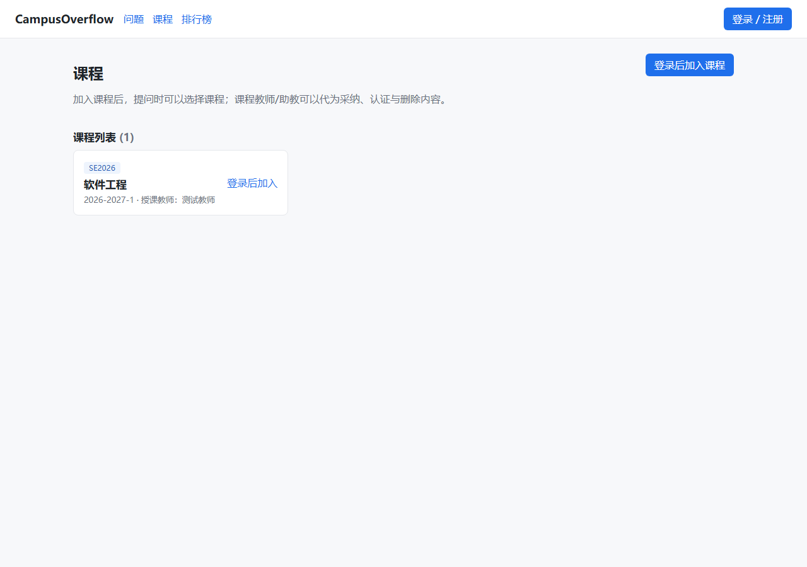
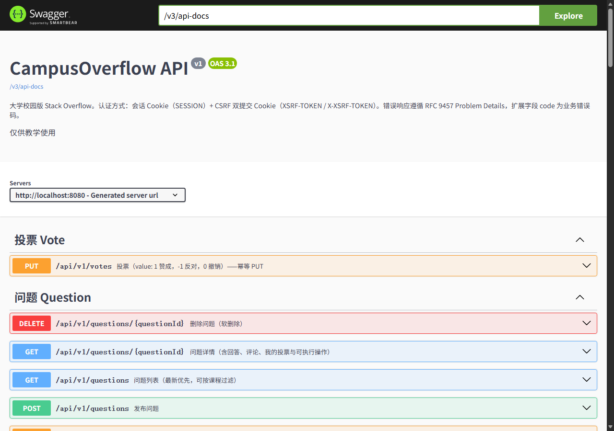

# Sprint 0 端到端验证记录（T0-03 / T0-05 / T0-09）

> 环境：Windows 11 + JDK 21.0.1 + Maven 3.9.16 + Docker 29.9.2 + Node 24.18.0
> 时间：2026-10-26 18:46–18:52（Asia/Shanghai）
> 服务：MySQL 8.0.39（宿主 3307）+ Redis 7（6379）+ Spring Boot（8080）+ Vite（5173）

## 1. 启动与健康检查

```text
docker ps
co-mysql | Up (healthy) | 0.0.0.0:3307->3306/tcp
co-redis | Up (healthy) | 0.0.0.0:6379->6379/tcp

GET http://localhost:8080/actuator/health
200 {"status":"UP","groups":["liveness","readiness"]}

GET http://localhost:8080/swagger-ui.html
200 → /swagger-ui/index.html
GET /v3/api-docs  → 包含 /api/v1/auth/* 与 /api/v1/courses/* 等路径
```

> 启动前发现并修复：`application.yml` 的 JDBC URL 把 Java 字符集写成了 MySQL 的 `utf8mb4`，
> Connector/J 9.1 建连即抛 `UnsupportedEncodingException: utf8mb4`。改为 `characterEncoding=UTF-8`
> 后 Flyway 校验 5 个迁移、连接池正常，后端起在 8080。

## 2. 注册 → 登录 → 建课 → 加入课程

测试账号（仅本地开发库）：

| 角色 | username | password | 说明 |
| --- | --- | --- | --- |
| 教师 | `T2001` | `Teacher2026` | 注册后用 SQL 提升为 TEACHER，再重新登录 |
| 学生 | `stu2026001` | `Campus2026` | 正常注册，加入课程 |

### 2.1 注册

```http
POST /api/v1/auth/register
X-XSRF-TOKEN: <XSRF-TOKEN cookie 的值>
Content-Type: application/json

{"username":"T2001","displayName":"测试教师","email":"t2001@example.edu",
 "password":"Teacher2026","college":"计算机学院","className":""}
→ 201 {"id":4}

{"username":"stu2026001","displayName":"测试学生","email":"stu2026001@example.edu",
 "password":"Campus2026","college":"计算机学院","className":"软工2026-1"}
→ 201 {"id":5}
```

> CSRF 细节：`GET /api/v1/auth/csrf` 的**响应体 token 与 Cookie 值不同**；Spring Security 校验的是
> `XSRF-TOKEN` Cookie 的值。前端 `api.ts` 与 `http/auth.http` 都从 Cookie 取值（URL decode 后放
> `X-XSRF-TOKEN` 头）。直接用响应体 token 会 403 `AUTH-403-CSRF`。

### 2.2 提升教师角色（开发期）

```sql
UPDATE id_user SET role='TEACHER', verified=TRUE WHERE username='T2001';
```

> 会话缓存 Actor，改角色后必须**退出重新登录**。

### 2.3 教师登录并建课

```http
POST /api/v1/auth/login
{"username":"T2001","password":"Teacher2026"}
→ 200（SESSION Cookie 轮换）

POST /api/v1/courses
{"code":"SE2026","name":"软件工程","term":"2026-2027-1"}
→ 201 {"id":1}
```

### 2.4 学生登录并加入课程

```http
POST /api/v1/auth/login
{"username":"stu2026001","password":"Campus2026"}
→ 200

GET /api/v1/courses/mine
→ 200 []

POST /api/v1/courses/1/join
→ 204

GET /api/v1/courses/mine
→ 200 [{"id":1,"code":"SE2026","name":"软件工程","term":"2026-2027-1",
        "teacherId":4,"teacherName":"测试教师","myRole":"STUDENT"}]

GET /api/v1/courses
→ 200 [ ... 同上，myRole=STUDENT ]
```

**结论**：Sprint 0 验收要求的“注册 → 登录 → 课程列表 → 加入课程”链路在本地实测通过；
重复加入返回 409（幂等提示），未登录调用 join 返回 401/403（由 SecurityConfig 保护）。

## 3. 前端课程页（T0-09）

- 路由：`/courses`；导航栏“课程”；未登录可浏览课程列表，登录后可加入。
- 数据：`GET /api/v1/courses`（含 `myRole`）、`GET /api/v1/courses/mine`、`POST /api/v1/courses/{id}/join`。
- 交互：已加入显示角色徽标；未加入显示“加入课程”；加入成功后刷新列表与 `me.courses`（提问页下拉随之更新）。
- 构建：`npm run typecheck` 0 error；`npm run build` 成功。
- 手工验证：登录 `stu2026001` → `/courses` 显示《软件工程》与“已加入 STUDENT”；提问页课程下拉出现 `SE2026 软件工程`。

## 4. 复现命令

```bash
# 1) 中间件（3306 被本机 MySQL80 占用时）
DB_HOST_PORT=3307 docker compose -f deploy/docker-compose.yml up -d mysql redis

# 2) 后端
cd backend
DB_PORT=3307 mvn spring-boot:run -pl co-bootstrap -Dspring-boot.run.profiles=dev

# 3) 前端
cd frontend && npm install && npm run dev

# 4) 冒烟
# 打开 http/auth.http，按顺序运行；或按本文第 2 节的请求手工调用
```

## 5. 证据清单

- [x] `docker ps` 健康状态（本文第 1 节）
- [x] `/actuator/health` = UP
- [x] Swagger UI 200
- [x] 注册 201、登录 200、建课 201、加入 204、我的课程 200
- [x] 前端 typecheck/build 通过
- [x] 课程页截图：`screenshots/course-page.png`
- [x] Swagger UI 截图：`screenshots/swagger-ui.png`
- [ ] 其他成员环境验证（待补 `docs/sprint0/environment.md` 表格）

## 6. 截图

课程页（匿名浏览；登录后显示“加入课程”按钮与角色徽标）：



Swagger UI（`/swagger-ui/index.html`，Question / Vote 等分组可见）：


